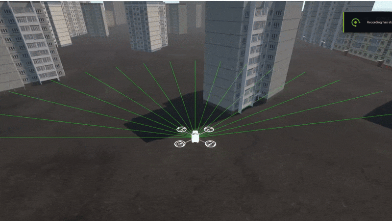

# Drone Navigation with Unity ML-Agents

A small autonomous drone that learns to fly through a procedurally generated city and reach a target, trained with reinforcement learning using **Unity ML-Agents**. Built as a university project for an Artificial Intelligence course.

<!-- Replace with your own GIF/screenshot: put files in /docs and link them here -->

## Overview

The drone spawns at one end of a city and has to reach a target placed at the opposite end, avoiding buildings along the way. The city layout is regenerated every episode, so the agent can't memorize a single route and has to learn general obstacle-avoidance behavior.

The drone has no camera. It senses the world through a simulated **LIDAR** (a fan of raycasts) plus information about its own motion and the direction to the goal.

## Features

- **Reinforcement learning agent** built on Unity ML-Agents (`Agent` subclass with continuous actions)
- **Simulated LIDAR**: 16 rays spread across a 180° forward arc, 10 m range
- **Procedural environment**: buildings are re-spawned at the start of every episode via a `BuildingSpawner`
- **Randomized start and goal positions** each episode for better generalization
- **Reward shaping** combining progress toward the target, a time penalty, proximity penalties, and terminal rewards
- **Human-in-the-loop control**: keyboard input is blended with the agent's actions, so you can fly the drone yourself or nudge the AI mid-flight
- **Pre-trained model** included as an `.onnx` file, so you can watch the trained drone without training anything

## How it works

### Observations (30 values)

| Observation | Size | Notes |
|---|---|---|
| Distance to target | 1 | Normalized by max distance (150) |
| Direction to target | 3 | Unit vector |
| Linear velocity | 3 | Normalized by max velocity |
| Angular velocity | 3 | Normalized |
| Rotation | 4 | Quaternion |
| LIDAR hits | 16 | Binary per ray (1 = obstacle detected within range) |

### Actions (3 continuous)

| Index | Action |
|---|---|
| 0 | Vertical thrust (up / down) |
| 1 | Forward / backward thrust |
| 2 | Left / right thrust |

Thrust is applied as a relative force on the drone's `Rigidbody`, with velocity clamped to a maximum.

### Rewards

| Event | Reward |
|---|---|
| Reaching the target | **+10** |
| Hitting an obstacle | **-5** (episode ends) |
| Flying too far from the target (> 150 units) | **-5** (episode ends) |
| Any LIDAR ray detecting an obstacle | -0.3 per step |
| Every step (encourages speed) | -0.005 |
| Getting closer to the target | +0.1 × distance gained per step |

### Episode setup

- The drone spawns at a random position at the start side of the map, facing the city.
- The target spawns at a random position on the far side.
- The city is regenerated before each episode.

## Controls (manual / assisted mode)

| Key | Action |
|---|---|
| `W` / `S` | Forward / backward |
| `A` / `D` | Left / right |
| `Space` | Ascend |
| `Left Ctrl` | Descend |

When a trained model is running, human input is mixed with the AI's output (the human input is weighted slightly higher), so you can steer the drone while it's flying.

## Tech stack

Unity · C# · Unity ML-Agents · ONNX (Barracuda/Inference Engine) · Reinforcement Learning

*Developed as a project for the "Artificial Intelligence" course.*
